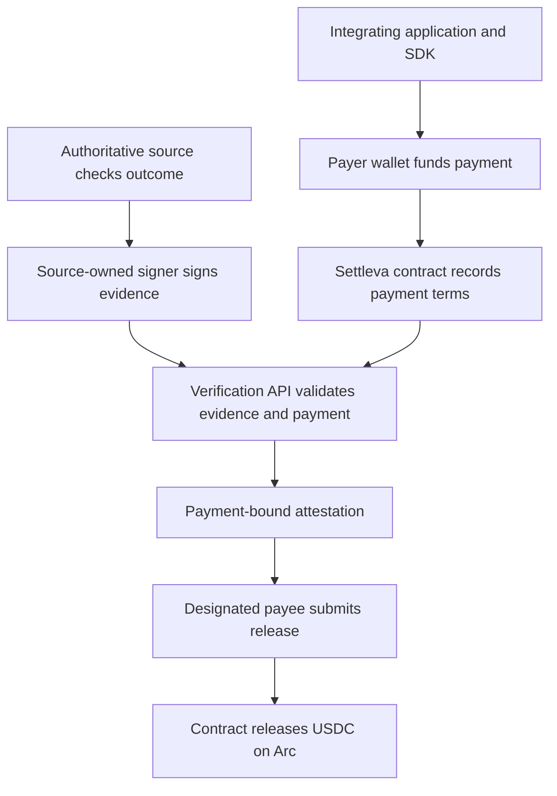

# Settleva

**Developer infrastructure for policy-based, evidence-driven USDC settlement on Arc.**

## 🎥 Demo

[](https://www.youtube.com/watch?v=BlX305PJu84)

[Open the live demo](https://settleva.vercel.app) · [Watch on YouTube](https://youtu.be/BlX305PJu84)


Settleva gives application developers a reusable Solidity escrow contract, a TypeScript SDK, deterministic payment-condition primitives, and a server-side evidence-verification boundary. Integrators define the terms of a payment in code, connect the system that can authoritatively confirm the outcome, and allow the designated payee to release funds only when a valid payment-bound attestation is accepted by the contract.

The product is the **SDK, contract, and integration protocol**. Settleva is not intended to be a single hosted marketplace or a new consumer wallet. Each integrator can build its own product and own the application, wallet experience, authoritative source, and operational deployment.

[Live website](https://settleva.vercel.app) · [Attestation API](https://settleva-api.185-7-81-139.sslip.io/api/evidence/attest) · [Arc contract](https://explorer.arc.io/address/0x104E6D889875c5bac04c6a17cfb66d74b4638e95) · [Contract deployment transaction](https://explorer.arc.io/tx/0xd1e46746f7c647dc2c4a749d6a0803edd1857585f3dc411209a91c659775c189) · [Documentation index](docs/README.md)

## The problem Settleva addresses

Many digital transactions depend on an outcome that happens outside a blockchain: a game match ends, a freelancer completes an agreed milestone, an order is delivered, or an autonomous agent finishes a task. An application may want to hold USDC until that outcome is confirmed, but the source data usually lives in a Web2 service while the funds and release rules live on-chain.

That creates an integration problem. The application must define exactly what qualifies, bind that policy to a funded payment, establish which source is trusted to report the outcome, prevent evidence from being reused against another payment, and make the final release enforceable by the contract.

Settleva provides common building blocks for that flow:

- **Payment-specific conditions.** Each payment commits to its own provider identity, claims, expiry, amount, payer, and payee.
- **A reusable escrow contract.** The contract enforces payment state and release/refund rules for the supported Arc USDC token.
- **A TypeScript SDK.** Applications can normalize payment inputs and build typed calls without handing private keys to the SDK.
- **A signed evidence boundary.** An integrator's backend checks source evidence, payment bindings, and replay state before issuing a payment-bound attestation.
- **An integrator-owned deployment model.** Developers can deploy their own contract instance and operate the backend and source integration appropriate to their product.

The goal is to make the settlement mechanism reusable while keeping application-specific truth, trust, and user experience explicit.

## Current deployment status

As of **14 October 2026**, the demo contract is deployed on Arc mainnet, the standalone attestation API is reachable over HTTPS, the backend mainnet preflight passed 19/19 checks, and a low-value escrow was released successfully on-chain.

This is a **verified prototype**, not yet a turnkey production service with independently operated providers for every example scenario. See [Deployment status and evidence](docs/STATUS.md) for the exact test scope and remaining gaps.

| Item | Current demo |
|---|---|
| Network | Arc mainnet, chain ID `5042` |
| Settleva contract | `0x104E6D889875c5bac04c6a17cfb66d74b4638e95` |
| Immutable verification signer | `0xde98E7De50DBF3AFf588Ec510056Bd010cFc37Cf` |
| Arc USDC ERC-20 interface | `0x3600000000000000000000000000000000000000` · 6 decimals |
| Website | [settleva.vercel.app](https://settleva.vercel.app) |
| Attestation endpoint | `POST /api/evidence/attest` on the public API host |
| Published packages | [`@settleva/sdk@0.1.1`](https://www.npmjs.com/package/@settleva/sdk) · [`@settleva/conditions@0.1.1`](https://www.npmjs.com/package/@settleva/conditions) |

## What has been verified

The following are completed test and deployment observations, rather than planned capabilities:

- Arc mainnet reported chain ID `5042`; the deployed contract bytecode, canonical Arc USDC interface, and immutable verifier address were checked.
- The backend mainnet preflight passed **19 of 19 checks**.
- The Solidity contract test suite passed **17 Arc Foundry tests**.
- The public attestation route responds over HTTPS. A GET to the POST-only route returns `405 Method Not Allowed`, and unrelated paths on its dedicated hostname return `404`.
- A controlled **0.01 USDC** payment was approved, funded, attested, and released. The final on-chain payment status is `Released (2)`, the proof identifier is marked used, and the escrow contract's USDC balance is zero.
- The published SDK and conditions packages were installed from npm in a clean consumer project and their expected exports were checked.

### On-chain transaction evidence

| Action | Transaction |
|---|---|
| Contract deployment | [View on Arc Explorer](https://explorer.arc.io/tx/0xd1e46746f7c647dc2c4a749d6a0803edd1857585f3dc411209a91c659775c189) |
| Test USDC approval | [View on Arc Explorer](https://explorer.arc.io/tx/0xa233733383b8cf0336c8e2edd5718148d4546511a4d63980427c04937f7512f5) |
| Test escrow creation | [View on Arc Explorer](https://explorer.arc.io/tx/0x46c59b0a2c2ff582a0a180113f8a1ff3e69c16330b70ecea7bb6f2ba2c8cd164) |
| Test release | [View on Arc Explorer](https://explorer.arc.io/tx/0x445ee9c064d394ead51126abd4b0de76f165bd6a72c2fbecbce5877b15d831a7) |

**Important boundary of the settlement test:** a one-off adapter running on the operator's VPS queried GitHub's live Vercel deployment status and signed an assertion with its own Ed25519 key. GitHub did **not** cryptographically sign the Settleva evidence message, and the temporary adapter is not yet a reusable, version-controlled provider integration in this repository. The test also used the same wallet as payer and payee. It demonstrates a real backend/contract settlement path and on-chain release, but it does not prove an independently operated source trust boundary or a normal two-party customer transaction.

## How settlement works

1. **Define the terms.** The integrating application uses the SDK to prepare a payment with a specific payer, payee, token, amount, expiry, provider identity, and condition.
2. **Fund the payment.** The payer approves the required Arc USDC amount and creates the payment. The contract stores the commitments and emits a `PaymentCreated` event.
3. **Confirm the external outcome.** The authoritative source system checks its own records and signs an evidence event. The payer's browser or the evaluated agent must not be the sole authority for a disputed outcome.
4. **Verify and bind.** The Settleva backend checks the signature and freshness, exact provider and condition, funded on-chain payment, expiry, verifier configuration, and persistent replay state.
5. **Attest.** If the checks pass, the backend issues a payment-bound attestation. The API does not submit the release transaction itself.
6. **Release or refund.** The designated payee submits the release to the contract. The contract checks the attestation and payment state before transferring USDC. If the payment expires unreleased, the payer can use the contract's refund path.



This is a **backend-attested** design. The contract does not independently validate arbitrary Web2 source data; it trusts its configured, immutable verification signer to attest only after the backend's checks pass. Read the [architecture](docs/ARCHITECTURE.md) and [security model](docs/SECURITY_MODEL.md) before using real funds.

## For developers

The website is a policy playground and introduction to the integration model. The published SDK and contract are intended to be used from your own application; you do not need to build on top of the Settleva website.

### Install the SDK

```bash
pnpm add @settleva/sdk
# or
npm install @settleva/sdk
```

The SDK uses viem to prepare contract calls. Connect the wallet with your application's own wallet library, choose your deployed Settleva contract address, and make the wallet client submit the calls. The SDK does not custody funds, connect a wallet automatically, receive private keys, deploy a contract, or independently verify an external event.

### Prepare a payment

The following is an integration sketch. Values such as `payer`, `payee`, `arcUsdcAddress`, `settlevaAddress`, `walletClient`, and `account` must come from your application and wallet integration.

```ts
import {
  buildApprovalCall,
  buildCreatePaymentCall,
  prepareCreatePayment,
} from "@settleva/sdk";
import type { PaymentCondition } from "@settleva/sdk";

const expiresAt = Math.floor(Date.now() / 1000) + 86_400;

const condition: PaymentCondition = {
  version: "1.0",
  provider: "your-source-provider",
  providerVersion: "1",
  claims: [
    {
      field: "milestone.status",
      operator: "equals",
      value: "accepted",
    },
  ],
  expiresAt,
};

const prepared = prepareCreatePayment({
  payer,
  payee,
  token: arcUsdcAddress,
  amount: "25",
  expiry: expiresAt,
  condition,
});

// Submit with your own wallet client; the SDK never receives a private key.
const approvalCall = buildApprovalCall(prepared, settlevaAddress, 6);
const approvalHash = await walletClient.writeContract({
  account,
  ...approvalCall,
});

// Wait for the approval receipt before funding.
const fundingCall = buildCreatePaymentCall(prepared, settlevaAddress, 6);
const fundingHash = await walletClient.writeContract({
  account,
  ...fundingCall,
});
```

In this example, `amount: "25"` represents 25 USDC and the ERC-20 uses six decimals. In production code, wait for and verify the transaction receipts and the resulting on-chain payment state before asking a provider to attest to the outcome. See the full [SDK guide](packages/sdk/README.md) and [signed evidence provider guide](docs/integrations/SIGNED_EVIDENCE_PROVIDERS.md) before wiring a source into a real payment.

### What a provider integration must do

A policy is not an oracle. A valid integration needs an actual authoritative system, a controlled source-owned signing key, exact provider ID/version registration, a defined mapping from the source's event to the payment's claims, and tests for invalid, stale, mismatched, and replayed evidence. The source must independently know the outcome it signs.

The condition engine currently supports the exact `equals` operator. Do not assume ranges, arbitrary expressions, or a built-in connector for every service are supported.

## The four website scenarios

The homepage contains working local interactions that evaluate sample policies and sample evidence with the condition engine. They are coded demonstrations, not static images, but they are **not live payment integrations**.

| Scenario | What the playground demonstrates | Live authoritative source |
|---|---|---|
| Gaming rewards | Example match and result claims | Not connected |
| Freelance milestones | Example milestone and acceptance claims | Not connected |
| Conditional commerce | Example order and delivery claims | Not connected |
| Agentic economy | Example task-completion claims | Not connected |

These homepage scenarios do not connect a wallet, create escrow, call a live evidence provider, or transfer USDC. A scenario should be described as a live integration only after its real authoritative source is connected to the signed-evidence protocol and passes an end-to-end acceptance test on Arc.

## Repository layout

| Path | Responsibility |
|---|---|
| `apps/web/` | Next.js website, local scenario playground, and attestation API route |
| `packages/conditions/` | Payment-condition types, canonicalization, hashing, and deterministic claim evaluation |
| `packages/sdk/` | Payment preparation, amount conversion, and typed contract-call builders |
| `packages/verification/` | Persistent replay-protection logic |
| `packages/providers/` and `packages/core/` | Provider utilities and shared primitives |
| `contracts/` | Solidity settlement contract, deployment script, and tests |
| `future-integrations/reclaim/` | Preserved deferred experiment; not part of the current V1 runtime path |
| `docs/` | Architecture, deployment evidence, runbook, security model, provider guide, and roadmap |

## Local development

### Requirements

- Node.js 22 or later
- pnpm 10.15.0
- [Circle's Arc Foundry](https://github.com/circlefin/arc-foundry) for Arc-specific contract testing

### Install, check, test, and build

From the repository root:

```bash
pnpm install --frozen-lockfile
pnpm check
pnpm test
pnpm build
```

From `contracts/` on a system with Arc Foundry installed:

```bash
FOUNDRY_PROFILE=arc arc-forge build --sizes
FOUNDRY_PROFILE=arc arc-forge test -vvv
```

Do not broadcast a deployment just because the build passes. Review the [mainnet deployment runbook](docs/MAINNET_DEPLOYMENT_RUNBOOK.md), verify all addresses and keys locally, and complete the valid and negative-case acceptance tests before treating a deployment as production-ready.

## Security and trust boundaries

- Never commit private keys, provider signing keys, database credentials, generated secret files, or production environment files.
- Keep the deployment key, verifier key, and authoritative source's signing key separate; they have different responsibilities.
- Treat provider claims as untrusted until the actual authoritative source validates and signs them.
- The verifier is immutable for a deployed contract instance. Changing it requires a replacement deployment.
- A green build, successful HTTP response, or passing mainnet preflight is not proof that an external source integration is production-ready.
- The current contract/backend flow has not been independently audited by a third party. Review [SECURITY.md](SECURITY.md) and the [security model](docs/SECURITY_MODEL.md) before using real funds.

## Documentation and roadmap

- [Deployment status and evidence](docs/STATUS.md) — current deployment, transaction links, what the test proves, and what remains unverified.
- [Architecture](docs/ARCHITECTURE.md) — components and trust boundaries.
- [Mainnet deployment runbook](docs/MAINNET_DEPLOYMENT_RUNBOOK.md) — configuration and acceptance gates.
- [Signed evidence provider guide](docs/integrations/SIGNED_EVIDENCE_PROVIDERS.md) — request protocol and source integration.
- [Security model](docs/SECURITY_MODEL.md) and [security reporting policy](SECURITY.md).
- [Roadmap and open gaps](docs/ROADMAP.md).
- [Documentation index](docs/README.md).
- [Agent guidance](AGENTS.md); [CLAUDE.md](CLAUDE.md) points Claude Code to the same repository-wide rules.

## License

Settleva is released under the [MIT License](LICENSE). Review that license before redistributing or incorporating the code into another project.
