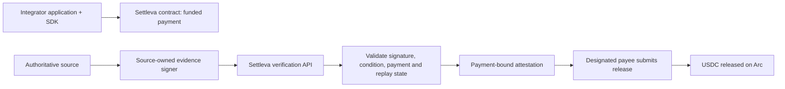

# Settleva

**Developer infrastructure for policy-based, evidence-driven USDC settlement on Arc.**

Settleva gives developers a reusable Solidity escrow contract, a TypeScript SDK, a deterministic condition engine, and a server-side verification boundary. An application defines the payment policy, connects an authoritative source for its outcome, and lets the designated payee submit a payment-bound release on Arc.

[Live website](https://settleva.vercel.app) · [Public API](https://settleva-api.185-7-81-139.sslip.io/api/evidence/attest) · [Arc contract](https://explorer.arc.io/address/0x104E6D889875c5bac04c6a17cfb66d74b4638e95) · [Deployment transaction](https://explorer.arc.io/tx/0xd1e46746f7c647dc2c4a749d6a0803edd1857585f3dc411209a91c659775c189)

## Current status

As of **14 October 2026**, the demo contract is deployed on Arc mainnet, the standalone attestation API is reachable over HTTPS, the backend mainnet preflight passed 19/19 checks, and a low-value escrow was released successfully on-chain.

This is a verified prototype, **not yet a turnkey production service with independently operated providers for all four scenarios**. The scope and limits of the settlement test are documented below and in [Deployment status](docs/STATUS.md).

| Item | Current demo |
|---|---|
| Network | Arc mainnet, chain ID `5042` |
| Settleva contract | `0x104E6D889875c5bac04c6a17cfb66d74b4638e95` |
| Immutable verification signer | `0xde98E7De50DBF3AFf588Ec510056Bd010cFc37Cf` |
| Arc USDC ERC-20 interface | `0x3600000000000000000000000000000000000000` · 6 decimals |
| Public attestation endpoint | `POST https://settleva-api.185-7-81-139.sslip.io/api/evidence/attest` |
| Published packages | [`@settleva/conditions@0.1.1`](https://www.npmjs.com/package/@settleva/conditions) · [`@settleva/sdk@0.1.1`](https://www.npmjs.com/package/@settleva/sdk) |

## What has been verified

- Arc mainnet reports chain ID `5042`; the deployed contract bytecode, canonical Arc USDC interface, and immutable verifier address were checked.
- The TypeScript check and production build pass. The Arc Foundry contract suite passed 17 tests, and the mainnet infrastructure preflight passed 19 checks.
- The public attestation route responds over HTTPS. A GET returns the expected `405 Method Not Allowed`; unrelated paths are blocked with `404`.
- A controlled **0.01 USDC** payment was approved, funded, attested, and released. The final on-chain payment status is `Released (2)`, the proof identifier is marked used, and the contract's USDC balance is zero.

Key transactions:

| Action | Transaction |
|---|---|
| Contract deployment | [View on Arc Explorer](https://explorer.arc.io/tx/0xd1e46746f7c647dc2c4a749d6a0803edd1857585f3dc411209a91c659775c189) |
| Test USDC approval | [View on Arc Explorer](https://explorer.arc.io/tx/0xa233733383b8cf0336c8e2edd5718148d4546511a4d63980427c04937f7512f5) |
| Test escrow creation | [View on Arc Explorer](https://explorer.arc.io/tx/0x46c59b0a2c2ff582a0a180113f8a1ff3e69c16330b70ecea7bb6f2ba2c8cd164) |
| Test release | [View on Arc Explorer](https://explorer.arc.io/tx/0x445ee9c064d394ead51126abd4b0de76f165bd6a72c2fbecbce5877b15d831a7) |

**Important test boundary:** the evidence test used a temporary VPS-side adapter that queried GitHub's live Vercel deployment status and signed an assertion with its own Ed25519 key. GitHub did not cryptographically sign the Settleva evidence message, and this temporary adapter is not yet included as a reusable, version-controlled provider integration in this repository. The test also used the same wallet as payer and payee. It proves the backend/contract settlement path with a real on-chain release; it does not yet prove an independently operated source provider or a normal two-party customer workflow. See [Deployment status](docs/STATUS.md).

## The four website scenarios

The homepage playground contains real application code for all four policy examples. The condition engine evaluates example policies against sample evidence locally.

| Scenario | Demo behavior | Live source integration |
|---|---|---|
| Gaming rewards | Evaluates sample match/result claims | Not connected |
| Freelance milestones | Evaluates sample milestone/acceptance claims | Not connected |
| Conditional commerce | Evaluates sample order/delivery claims | Not connected |
| Agentic economy | Evaluates sample task-completion claims | Not connected |

These are not static screenshot-only interactions, but neither are they live escrow flows. The homepage playground does not connect a wallet, create a payment, verify an external source, sign a release attestation, or transfer USDC. Integrators provide their own authoritative systems and wallet UX.

## How settlement works



The source-signed evidence API verifies an Ed25519 signature over the exact request bytes, enforces a freshness window, checks the policy claims and condition hash, confirms the on-chain payment is funded/unexpired and bound to the same provider/condition, and applies PostgreSQL replay protection before issuing an attestation. The contract accepts that attestation from the designated payee. The API **does not submit the release transaction itself**.

This is a backend-attested design: the contract does not independently validate arbitrary Web2 source data. See [Architecture](docs/ARCHITECTURE.md) and [Security model](docs/SECURITY_MODEL.md).

## Repository layout

- `apps/web/` — Next.js website, local scenario playground, and attestation API route.
- `packages/conditions/` — condition schema, canonicalization, hashing, and deterministic claim evaluation.
- `packages/sdk/` — payment preparation, amount conversion, attestation hashing, and contract-call builders.
- `packages/verification/` — persistent replay protection.
- `packages/providers/` and `packages/core/` — provider utilities and shared primitives.
- `contracts/` — canonical Solidity settlement contract, deployment script, and tests.
- `future-integrations/reclaim/` — preserved deferred experiment; not part of the V1 runtime path.

## Development

Requirements: Node.js 22+, pnpm 10.15.0, and [Circle's Arc Foundry](https://github.com/circlefin/arc-foundry) for Arc-specific contract testing.

From the repository root:

```bash
pnpm install --frozen-lockfile
pnpm check
pnpm test
pnpm build
```

From `contracts/` on a system with Arc Foundry installed:

```bash
FOUNDRY_PROFILE=arc arc-forge build --sizes
FOUNDRY_PROFILE=arc arc-forge test -vvv
```

See the [documentation index](docs/README.md) for deployment, integration, security, and roadmap notes. Coding-agent guidance is in [AGENTS.md](AGENTS.md); [CLAUDE.md](CLAUDE.md) points Claude Code to the same rules.

## Security and scope

- Never commit private keys, provider signing keys, database credentials, generated secret files, or production environment files.
- The deployment key, verifier key, and authoritative source's evidence-signing key have different responsibilities and must not be reused.
- Do not present the four scenario demos or the temporary GitHub-status adapter as independently validated production integrations.
- A successful build, HTTP response, or mainnet preflight does not by itself prove a settlement. Report only transaction and source evidence that can be independently checked.
- The contract has an immutable verifier address. Changing the verifier for an existing deployment requires a replacement deployment.

This is not a third-party smart-contract audit. Review [SECURITY.md](SECURITY.md) and the [Security model](docs/SECURITY_MODEL.md) before using real funds.
